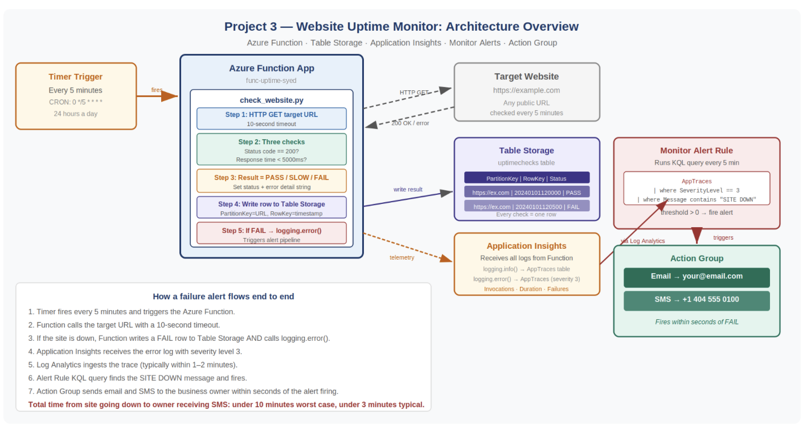

# 🌐 Website Uptime Monitor on Azure

**Status:** ✅ Complete — deployed with Terraform, checks running every 5 minutes, and failure alerts wired to email + SMS

Serverless uptime monitoring on Azure: a timer-triggered Python Azure Function checks a website every 5 minutes, writes every result to Table Storage, and logs failures to Application Insights. An Azure Monitor log alert watches for `SITE DOWN` traces and fires an Action Group that emails and texts the business owner — usually within a few minutes of the site going down.

## 🎬 Video Walkthrough

> 🎥 **Loom walkthrough:** [Watch the full build (≈4 min)](https://loom.com/share/03f651c7f1504aaab6060f3650119269)

## 📖 Project Overview

Most small businesses find out their website is down the worst possible way — from a customer. By then, orders, bookings, or leads have already been lost, and nobody knows how long it's been broken. This project closes that blind spot: an automated monitor that checks the site around the clock and tells the owner the moment something goes wrong.

- **Checks every 5 minutes, 24 hours a day** — HTTP GET with a 10-second timeout.
- **Three outcomes per check** — `PASS` (HTTP 200 under 5 s), `SLOW` (HTTP 200 but over 5,000 ms), or `FAIL` (non-200, connection refused, timeout, or any other error).
- **A permanent history** — every check, pass or fail, is a row in Table Storage, so you can see exactly when an outage started and ended.
- **Alerting with no extra code** — the function just logs an error; Application Insights, Log Analytics, an alert rule, and an Action Group turn that into an email and SMS.

**Business outcome:** the owner hears about an outage in minutes from an alert, not hours later from an unhappy customer.

### Skills Demonstrated

- Infrastructure as Code with Terraform (`azurerm` provider): storage, monitoring, compute, and alerting in one deployment
- Serverless compute — Linux Azure Function on the Consumption (`Y1`) plan with a CRON timer trigger
- Azure Table Storage — schema-less result history with `TableServiceClient`
- Observability pipeline — Application Insights (workspace-based) → Log Analytics → KQL
- Azure Monitor scheduled query alert (v2) with auto-mitigation, plus an Action Group with email and SMS receivers
- Defensive Python — explicit handling for connection errors, timeouts, and non-200 responses, with the storage write isolated so it can't mask the alert

## 🏗️ Architecture Diagram



**How a failure alert flows end to end:**

1. The timer fires every 5 minutes (`0 */5 * * * *`) and runs `check_website`.
2. The function calls the target URL with a 10-second timeout.
3. On a failure it writes a `FAIL` row to Table Storage **and** calls `logging.error("SITE DOWN: …")`.
4. Application Insights records the trace in `AppTraces` with severity level 3 (Error).
5. Log Analytics ingests the trace, typically within 1–2 minutes.
6. The alert rule's KQL query finds the `SITE DOWN` message on its 5-minute evaluation and fires.
7. The Action Group emails and texts the owner within seconds of the alert firing.

> **Implementation notes vs. the diagram:** the function uses a fixed `PartitionKey` of `"uptime"` rather than the URL, because Table Storage forbids `/` and `:` in keys (see Troubleshooting). A `SLOW` result also logs `SITE DOWN`, so the alert covers degraded performance as well as hard failures.

## ✅ Prerequisites

| Requirement | How to verify (PowerShell) |
|---|---|
| Azure CLI installed and signed in | `az account show` |
| Terraform v1.5+ | `terraform -version` |
| Active Azure subscription with Consumption (`Y1`) Function quota in your region | `az account list --output table` |
| A phone number that can receive SMS (US, `+1` country code) | — |

> 💰 **Cost:** the Consumption plan is effectively free at one execution every 5 minutes. Storage, Log Analytics ingestion, and SMS notifications carry small charges — tear it down when you're done.

## 📁 Repository Structure

```
.
├── main.tf                     # RG, storage + table, Log Analytics, App Insights, Y1 plan, Function App, Action Group, alert rule
├── variables.tf                # yourname, location, target_url, alert_email, alert_phone, tags
├── outputs.tf                  # Function App, App Insights, storage account/table, workspace ID
├── terraform.tfvars.example    # Copy to terraform.tfvars (gitignored) and fill in
├── .gitignore
├── docs/
│   └── architecture-diagram.png
└── function_app/
    ├── host.json               # Functions runtime v2 + App Insights sampling
    ├── requirements.txt        # azure-data-tables, requests
    └── check_website/          # Folder name = function name
        ├── function.json       # Timer trigger: every 5 minutes
        └── check_website.py    # The check logic (scriptFile)
```

## 🏷️ Naming Conventions

All names use the `yourname` suffix from `terraform.tfvars` — `syed` in my deployment.

| Resource | Name |
|---|---|
| Resource Group | `rg-uptime-monitor-syed` |
| Storage Account / Table | `stuptimesyed` / `uptimechecks` |
| Log Analytics Workspace | `law-uptime-syed` |
| Application Insights | `appi-uptime-syed` |
| App Service Plan (Consumption, Linux) | `asp-uptime-syed` |
| Function App / Function | `func-uptime-syed` / `check_website` |
| Action Group | `ag-uptime-syed` (short name `uptime`) |
| Alert Rule | `alert-site-down-syed` |

> Keep `yourname` short and lowercase-alphanumeric: `stuptime<name>` must be globally unique and fit storage's 24-character, lowercase-only limit.

## 🔍 How the Check Works

| Condition | Result | `ErrorDetail` | Logs `SITE DOWN`? |
|---|---|---|---|
| HTTP 200 in ≤ 5,000 ms | `PASS` | — | No |
| HTTP 200 in > 5,000 ms | `SLOW` | `Response time …ms exceeded 5000ms` | Yes |
| Any non-200 status | `FAIL` | `HTTP <code>` | Yes |
| Connection refused / DNS failure | `FAIL` | `Connection refused — server unreachable` | Yes |
| No response in 10 s | `FAIL` | `Request timed out after 10 seconds` | Yes |
| Any other exception | `FAIL` | exception text | Yes |

**Table Storage row (one per check):**

| Column | Example |
|---|---|
| `PartitionKey` | `uptime` |
| `RowKey` | `20261021120500` (UTC, `YYYYMMDDHHMMSS`) |
| `CheckTime` | ISO-8601 UTC timestamp |
| `Status` | `PASS` / `SLOW` / `FAIL` |
| `ResponseMs` | `342` (0 if no response) |
| `ErrorDetail` | empty on `PASS` |
| `TargetUrl` | `https://example.com` |

**Alert rule (`alert-site-down-syed`):** severity 1, scoped to `law-uptime-syed`, evaluated every 5 minutes over a 5-minute window, auto-resolves when failures stop:

```kusto
AppTraces
| where SeverityLevel == 3
| where Message contains "SITE DOWN"
| summarize count() by bin(TimeGenerated, 5m)
| where count_ > 0
```

## 🪜 Deployment Steps

### Step 1 — Clone and configure

```powershell
git clone https://github.com/salmanshah4/Uptime-Monitor.git
```

```powershell
cd Uptime-Monitor
```

```powershell
Copy-Item terraform.tfvars.example terraform.tfvars
```

Edit `terraform.tfvars`:

```hcl
yourname    = "<your-lowercase-name>"
location    = "East US"            # use "West US 2" if East US has no Y1 quota
target_url  = "https://example.com"
alert_email = "<you@example.com>"
alert_phone = "+14045550100"       # E.164; Terraform strips +1 and dashes for the SMS receiver
```

### Step 2 — Deploy the infrastructure

```powershell
az login
```

```powershell
terraform init
```

```powershell
terraform plan "-out=main.tfplan"
```

```powershell
terraform apply main.tfplan
```

Quote the `-out=` argument in PowerShell, otherwise it splits on the period. When the Action Group is created you'll get a confirmation email and SMS that you've been added to it.

### Step 3 — Deploy the function code

Zip the contents of `function_app/` with forward-slash paths (`Compress-Archive` writes backslashes, which a Linux Function App can't read as folders):

```powershell
cd function_app
```

```powershell
python -c "import zipfile,os; z=zipfile.ZipFile('../function_deploy.zip','w',zipfile.ZIP_DEFLATED); [z.write(os.path.join(r,f), os.path.relpath(os.path.join(r,f),'.').replace(os.sep,'/')) for r,d,fs in os.walk('.') if '__pycache__' not in r for f in fs]; z.close()"
```

```powershell
cd ..
```

```powershell
az functionapp deployment source config-zip --resource-group rg-uptime-monitor-syed --name func-uptime-syed --src function_deploy.zip --build-remote true
```

`--build-remote true` installs `requests` and `azure-data-tables` on Linux during deployment, so no Windows wheels end up in the package. Confirm the function registered:

```powershell
az functionapp function list --resource-group rg-uptime-monitor-syed --name func-uptime-syed --query "[].name" -o tsv
```

Expected: `func-uptime-syed/check_website`.

### Step 4 — Verify checks are running

**Table Storage rows** (wait at least one 5-minute cycle):

```powershell
$conn = az storage account show-connection-string --name stuptimesyed --resource-group rg-uptime-monitor-syed --query connectionString -o tsv
```

```powershell
az storage entity query --table-name uptimechecks --connection-string $conn --query "items[].{Time:CheckTime, Status:Status, Ms:ResponseMs, Error:ErrorDetail}" -o table
```

**Application Insights traces** — Portal → `appi-uptime-syed` → **Logs**:

```kusto
AppTraces
| where Message startswith "Check:" or Message contains "SITE DOWN"
| project TimeGenerated, SeverityLevel, Message
| order by TimeGenerated desc
| take 20
```

**Alert rule is enabled:**

```powershell
az monitor scheduled-query show --name alert-site-down-syed --resource-group rg-uptime-monitor-syed --query "{Enabled:enabled, Severity:severity, Frequency:evaluationFrequency}" -o table
```

### Step 5 — Test the alert end to end

Point the monitor at a URL that can't resolve, so the next check fails:

```powershell
az functionapp config appsettings set --resource-group rg-uptime-monitor-syed --name func-uptime-syed --settings TARGET_URL=https://this-site-does-not-exist.invalid
```

Within roughly 5–10 minutes you should see a `FAIL` row in Table Storage, a severity-3 `SITE DOWN` trace in Application Insights, and the email + SMS from `ag-uptime-syed`. Then set it back:

```powershell
az functionapp config appsettings set --resource-group rg-uptime-monitor-syed --name func-uptime-syed --settings TARGET_URL=https://example.com
```

The alert auto-resolves once a window passes with no failures.

## 🎞️ Build Walkthrough (Loom timestamps)

**1. Define the business problem and monitoring goal** — [0:00](https://loom.com/share/03f651c7f1504aaab6060f3650119269?t=0)


A blind-spot detector: find out the site is down, slow, or broken before customers do — faster detection, fewer complaints, better visibility into site health.

**2. Identify what the monitor should check** — [0:46](https://loom.com/share/03f651c7f1504aaab6060f3650119269?t=46)


Availability, page load speed, correct responses, and general health — and a clear definition of what counts as a failure.

**3. Review the infrastructure and code components** — [1:24](https://loom.com/share/03f651c7f1504aaab6060f3650119269?t=84)


`variables.tf`, `main.tf`, `outputs.tf`, and the Python check logic in `check_website.py`.

**4. Verify the Function App is enabled and running** — [1:48](https://loom.com/share/03f651c7f1504aaab6060f3650119269?t=108)


`func-uptime-syed` enabled and running without errors before any alert testing.

**5. Validate health metrics in Application Insights** — [2:17](https://loom.com/share/03f651c7f1504aaab6060f3650119269?t=137)


Overall health, exception rate, CPU, dependency calls, incoming requests, and trace activity all receiving data.

**6. Confirm the environment is collecting data** — [2:42](https://loom.com/share/03f651c7f1504aaab6060f3650119269?t=162)


If a view looks empty, check the deployment and telemetry settings before assuming the monitor is broken.

**7. Configure and test alert rules** — [3:13](https://loom.com/share/03f651c7f1504aaab6060f3650119269?t=193)


`alert-site-down-syed` fires on `SITE DOWN` traces and notifies the owner through the Action Group.

**8. Confirm the alerting workflow supports proactive response** — [3:47](https://loom.com/share/03f651c7f1504aaab6060f3650119269?t=227)


Alerts carry the URL, status, and error detail, so the team can act before customers report the problem.

## ✅ Verification Checklist

- [x] Resource group `rg-uptime-monitor-syed` with storage, Log Analytics, App Insights, plan, Function App, Action Group, and alert rule
- [x] `uptimechecks` table exists in `stuptimesyed`
- [x] Function App `func-uptime-syed` is running with `check_website` registered
- [x] A new Table Storage row appears every 5 minutes
- [x] `Check: …` traces visible in Application Insights
- [x] Alert rule `alert-site-down-syed` enabled and linked to `ag-uptime-syed`
- [x] Action Group has email and SMS receivers

## 🛠️ Troubleshooting

These are the issues documented in the code comments of `main.tf`, `variables.tf`, and `check_website.py`:

| Issue | Cause | Resolution |
|---|---|---|
| Table Storage writes appear to succeed but rows never show up | The original design used the target URL as `PartitionKey`; Table Storage forbids `/`, `:`, `#`, and `?` in keys | Use a fixed `PartitionKey` of `"uptime"` and store the URL in its own `TargetUrl` column |
| `AttributeError` calling `create_table_if_not_exists()` | That method exists on `TableServiceClient`, not `TableClient` | Create the table from `TableServiceClient`, then call `get_table_client()` for entity operations |
| Writing a `Timestamp` column has no effect / conflicts | `Timestamp` is a reserved system property Table Storage sets itself | Store the check time as `CheckTime` instead |
| `az functionapp deployment source config-zip` returns 409 Conflict | `WEBSITE_RUN_FROM_PACKAGE` set in `app_settings` conflicts with zip deployment | Leave `WEBSITE_RUN_FROM_PACKAGE` out of Terraform; `config-zip` works without it |
| Alert rule can't find any App Insights logs | A classic (non-workspace) Application Insights resource doesn't store `AppTraces` in Log Analytics | Set `workspace_id` on `azurerm_application_insights` so traces land in `law-uptime-syed` |
| `terraform apply` fails with a quota error in East US | The subscription has no Consumption (`Y1`) Function quota in that region | Set `location = "West US 2"` in `terraform.tfvars` |

## ⚠️ Cautionary Notes

- Don't rely on customer complaints as the first sign of failure — early detection is the whole point.
- Tune thresholds carefully; overly sensitive alerts train people to ignore them. `SLOW` currently alerts too, so raise the 5,000 ms limit if your site is legitimately slow.
- Deploy Terraform and the function code together; a missing piece silently stops monitoring.
- An empty dashboard usually means telemetry isn't flowing yet, not that the system is broken — Log Analytics ingestion can lag 1–2 minutes.
- Keep `terraform.tfvars` out of Git — it holds your email and phone number.

## 💡 Tips for Efficiency

- Validate the Function App and its registered function first, before troubleshooting dashboards or alerts.
- Use the Table Storage history as your uptime record instead of checking the site manually.
- Start with alerts on hard failures, then expand to performance and content checks.
- Document expected behavior for each metric so teammates can spot abnormal patterns quickly.
- Test the full alert path with an unresolvable `TARGET_URL` before you rely on it.

## 🧹 Cleanup

```powershell
terraform destroy
```

The Action Group is a global resource, so if destroy ever complains the resource group still has resources, delete `ag-uptime-syed` first and re-run.

## 🔭 Next Iteration

- Monitor multiple URLs from a list (one `PartitionKey` per site, with the URL encoded or hashed)
- Add a content check — confirm an expected string appears on the page, not just HTTP 200
- Separate alert rules and severities for `SLOW` vs `FAIL`
- Use the Function App's managed identity and a **Storage Table Data Contributor** role instead of the storage connection string
- Add a workbook showing uptime percentage and response-time trends from Table Storage and App Insights

## 🧠 Key Takeaways

- **Let the platform do the alerting.** The function only logs an error; Application Insights, Log Analytics, the alert rule, and the Action Group handle delivery. No email or SMS code to maintain.
- **Platform rules bite silently.** Forbidden key characters in Table Storage, a reserved `Timestamp` property, and a deployment-setting conflict each failed quietly or confusingly — every one is now documented in the code where the next person will look.
- **Wiring matters as much as resources.** App Insights without `workspace_id` deploys cleanly but leaves the alert rule blind. Each link in the pipeline has to be verified, not assumed.
- **The value is invisible when it works.** Nobody notices the outage that got fixed in five minutes — that's the deliverable: the owner finds out from an alert, not from a customer.

---

**Author:** [Syed Shah](https://github.com/salmanshah4) | **Project:** Website Uptime Monitor on Azure | **Stack:** Azure Functions · Table Storage · Application Insights · Azure Monitor · Terraform | **Difficulty:** Beginner–Intermediate
